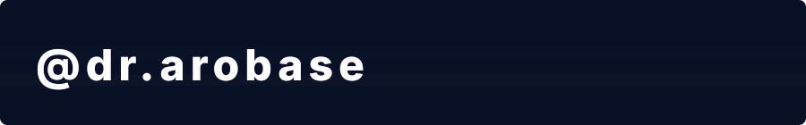
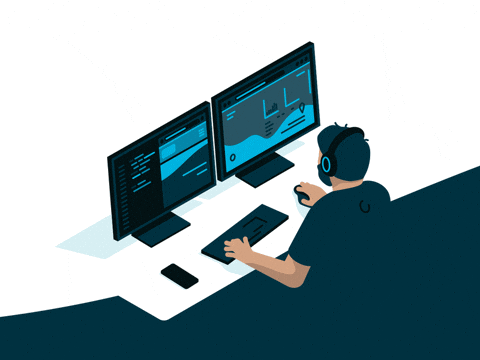

<!-- ══════════════════ HEADER ══════════════════ -->


<!-- Typing animation -->
<div align="center">

[](https://github.com/dr-arobase)



<p>
  
  
  
  
</p>

</div>

---

<!-- ══════════════════ ABOUT ME ══════════════════ -->

##  À propos de moi



```yaml
┌──────────────────────────────────────────┐
│          Dr. Arobase — Profil            │
├──────────────────────────────────────────┤
│  École    : Collège de Maisonneuve       │
│  Ville    : Montréal, Québec             │
│  Rôle     : Développeur Full Stack       │
│  Langues  : Français et Anglais          │
│  Fuel     : Café ++ & Musique lo-fi      │
│  Objectif : Build. Launch. Repeat.       │
│  Open à   : Collabs & Projets            │
└──────────────────────────────────────────┘
```

- 🌱 J'apprends continuellement de nouvelles technologies
- ⚡ Je construis des projets **concrets** et utiles
- 🎮 Quand je ne code pas — je joue, je lis ou j'explore
- 🤖 Fasciné par l'**IA** et ce qu'elle peut accomplir
- 💬 N'hésitez pas à me contacter pour **collaborer** !

<br clear="right"/>

---

<!-- ══════════════════ VIBE STATEMENT ══════════════════ -->

## 🔥 Mon état d'esprit

<div align="center">

```
✦ ━━━━━━━━━━━━━━━━  ULTIMATE FLOW STATE  ━━━━━━━━━━━━━━━━ ✦

  Coder comme un artiste, debugger comme un détective,
  déployer comme un astronaute. Je code le jour,
  j'apprends la nuit, et je rêve de produits qui changent
  le monde. Let's grind, build, and ship! 🚀

✦ ━━━━━━━━━━━━━━━━━━━━━━━━━━━━━━━━━━━━━━━━━━━━━━━━━━━━━━ ✦
```

</div>

---

<!-- ══════════════════ TECH STACK ══════════════════ -->

##  Tech Stack & Arsenal

<div align="center">

<p><em>Mon toolkit pour coder, créer et dominer les projets :</em></p>

###  Langages de programmation
<p>
	
</p>

###  Front-End
<p>
	
</p>

###  Back-End & Bases de données
<p>
	
</p>

###  DevOps & Outils
<p>
	
</p>

</div>

---

<!-- ══════════════════ VIDÉOS ══════════════════ -->

## 🎬 Vidéos

<div align="center">

<p><em>Clique sur un aperçu pour lancer la vidéo MP4 complète</em></p>

<table>
  <tr>
    <td align="center">
      <a href="assets/videos/kobeni_dance.mp4"></a>
      <br/><b>▶ Danse</b>
    </td>
    <td align="center">
      <a href="assets/videos/kobeni_acceuil.mp4"></a>
      <br/><b>▶ Accueil</b>
    </td>
    <td align="center">
      <a href="assets/videos/kobeni_pochita.mp4"></a>
      <br/><b>▶ Pochita</b>
    </td>
  </tr>
</table>

</div>

---

<!-- ══════════════════ GITHUB STATS ══════════════════ -->

## 📊 GitHub Stats & Grind

<div align="center">

<table>
  <tr>
    <td>
      
    </td>
    <td>
      
    </td>
  </tr>
</table>

<br/>


</div>

---

<!-- ══════════════════ TROPHÉES ══════════════════ -->

## 🏆 Trophées & Récompenses

<div align="center">


</div>

---

<!-- ══════════════════ PROJETS ══════════════════ -->

## 🚀 Projets épiques & Quêtes

<div align="center">

| 🔥 Projet | 📝 Description | 🛠️ Stack | 🔗 |
|-----------|----------------|----------|----|
| 🤖 **Bot IA Conversationnel** | Assistant virtuel intelligent avec NLP | Python · FastAPI · OpenAI | [](#) |
| 🌐 **Portfolio Interactif** | Site web animé 3D avec Three.js | React · Three.js · TailwindCSS | [](https://github.com/dr-arobase/portfolio-interactif) |
| 📊 **Dashboard Analytics** | Tableau de bord temps réel | Node.js · MongoDB · Chart.js | [](https://github.com/dr-arobase/dashboard-analytics) |
| 🎮 **Jeu Multijoueur** | Jeu web temps réel avec Socket.io | React · Socket.io · Express | [](#) |
| 🔐 **Auth Sécurisée** | Système d'authentification JWT/OAuth | Node.js · JWT · PostgreSQL | [](#) |
| ⚡ **Glitch Site** | Mini-site au style glitch avec lecteur vidéo | HTML · CSS · JS | [](glitch-site/) |

</div>

> 💡 *Découvrez tous mes projets — Level up avec mon [GitHub](https://github.com/dr-arobase?tab=repositories) !*

<details>
<summary><b>⚡ Lancer le Glitch Site en local</b></summary>

<br/>

```bash
# depuis la racine du repo
python -m http.server 8000
# puis ouvrir http://localhost:8000/glitch-site/
```

Déploiement : GitHub Pages (Settings → Pages → Branch `main` → `/ (root)`) ou import sur [Glitch](https://glitch.com/).

</details>

---

<!-- ══════════════════ SNAKE ══════════════════ -->

## 🐍 Mes contributions se font dévorer

<div align="center">

<picture>
  <source media="(prefers-color-scheme: dark)" srcset="https://raw.githubusercontent.com/dr-arobase/dr-arobase/output/github-contribution-grid-snake-dark.svg" />
  <source media="(prefers-color-scheme: light)" srcset="https://raw.githubusercontent.com/dr-arobase/dr-arobase/output/github-contribution-grid-snake.svg" />
  
</picture>

</div>

---

<!-- ══════════════════ ACTIVITÉ ══════════════════ -->

## 📈 Graphique d'activité

<div align="center">


</div>

---

<!-- ══════════════════ MISSION ══════════════════ -->

## 🎯 Ma Mission & Objectifs

<div align="center">

```
╔══════════════════════════════════════════════════════════╗
║                     ULTIMATE QUEST                       ║
╠══════════════════════════════════════════════════════════╣
║  Terminer mes études brillamment                         ║
║  Contribuer à des projets open-source impactants         ║
║  Maîtriser l'IA & le Machine Learning                    ║
║  Lancer mon propre produit SaaS                          ║
║  Décrocher un poste de rêve en tech                      ║
╠══════════════════════════════════════════════════════════╣
║  Grinding Now : Projets full-stack + Certifications      ║
║  Side Quests  : Algorithmes · LeetCode · Open Source     ║
╚══════════════════════════════════════════════════════════╝
```

</div>

---

<!-- ══════════════════ BLAGUE DEV ══════════════════ -->

## 😂 Blague de dev du jour

<div align="center">


</div>

---

<!-- ══════════════════ QUOTE ══════════════════ -->

## 💭 Citation inspirante

<div align="center">


</div>

---

<!-- ══════════════════ CONTACT ══════════════════ -->

## 🌐 Let's Team Up ! Me retrouver

<div align="center">

<p>✨ <strong>Prêt à vibe sur du code, des projets ou juste papoter tech ?</strong> Hit me up ! 👇</p>

<br/>

[](https://github.com/dr-arobase)
[](https://linkedin.com/in/dr-arobase)
[](https://twitter.com/dr-arobase)
[](https://discord.com/users/dr-arobase)
[](https://instagram.com/dr-arobase)
[](mailto:votre@email.com)
[](https://dr-arobase.github.io)

<br/>

### ☕ Offre-moi un café si tu aimes mon travail !

[](https://buymeacoffee.com/dr-arobase)

</div>

---

<!-- ══════════════════ FOOTER ══════════════════ -->

<div align="center">


<sub>⭐ <strong>Clique sur Star</strong> si un de mes repos t'a aidé — ça fait toujours plaisir ! ⭐</sub>

<br/>

<sub>Fait avec ❤️ et beaucoup de ☕ par <strong>Dr. Arobase</strong> — Montréal 🍁 — 2026</sub>

</div>
